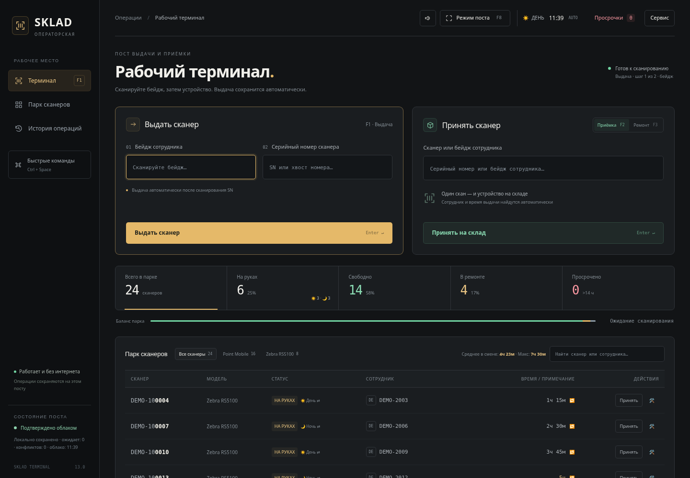

# Складской терминал сканеров

Статическое приложение для выдачи, возврата, замены и ремонта сканеров. Интерфейс на русском языке, локальное хранение IndexedDB, ID/PIN операторов и аудит действий, серверные транзакции PostgreSQL. Реальные устройства и бейджи в исходники не включаются.

## Структура

- `app.js` — формы, поиск, фильтры, карточка устройства и смены.
- `core.js` — проверка данных, сравнение копий, CSV и границы отчётов.
- `data.js` — IndexedDB v4, очередь атомарных операций, синхронизация и конфликты.
- `connection.js`, `operators.js` — подключение, проверка ID/PIN и интерфейс создателя.
- `backups.js` — серверные снимки, сравнение и восстановление.
- `reports.js`, `ui.js` — отчёты за период, клавиатурная доступность.
- `sw.js` — кэш только статических файлов для перезапуска без сети.
- `supabase/migrations/` — схема, RLS, RPC, индексы и расписание копий.
- `tests/` — проверки PostgreSQL/PGlite и сценарии Playwright с вымышленными данными.

## Запуск и проверки

Нужен Node.js 22 или новее. Приложение не требует сборки.

```sh
npm ci
npm run check
npm test
npx playwright install --with-deps chromium
npm run test:browser
node tests/server.cjs
```

Открыть `http://127.0.0.1:4173`. В этой версии используется проект Supabase, указанный в начале `app.js`. URL проекта и publishable key являются публичной конфигурацией; секретные ключи в браузере запрещены. Для другого проекта обновите также `connect-src` в CSP страницы.

Браузерные тесты перехватывают все запросы Supabase и используют синтетический API. Тесты SQL выполняют настоящие транзакции в отдельной PGlite-базе в памяти, не подключаясь к рабочей базе. Для системного Chromium можно задать `PLAYWRIGHT_CHROMIUM_EXECUTABLE=/usr/bin/chromium`.

## Операторы и журнал создателя

Перед работой сотрудник вводит свой ID и личный PIN. Создатель добавляет операторов и видит журнал их действий с фильтрами и состояниями устройств до/после. Автор операции определяется проверенной сессией; получатель оборудования указывается отдельно.

[Настройка, права и офлайн-очередь](docs/OPERATOR-AUDIT.md). PIN и ключи первоначальной настройки не хранятся в репозитории. Одноразовый ключ выдаётся создателю приватно.

## Надёжность и ограничения

- Состояние, очередь и локальный журнал записываются одной транзакцией IndexedDB. Замена двух сканеров — одна операция и в браузере, и на сервере.
- Каждый запрос содержит исходные версии. Конфликт не перезаписывает облако и не удаляет очередь. Повторы одного идентификатора идемпотентны.
- После первой полной загрузки сервер возвращает только изменения с курсора, включая списанные устройства. Списание сохраняет журнал и tombstone.
- Новые операции записывают проверенный ID оператора и идентификатор терминала; автор старых неподписанных записей не восстанавливается догадкой. Старая очередь v10/v11 сохраняется для сверки, не отправляется без проверки исходного состояния.
- Согласование с облаком архивирует рассмотренные операции в IndexedDB `meta`, не удаляя появившиеся за время подтверждения сканы. Сначала скачайте очередь и сверьте физическую выдачу.
- Без сети операции доступны после первого PIN-входа в пределах 12-часовой сессии. Подписанные пакеты сохраняют исходного автора после смены сотрудника; для нового входа требуется облако.
- Локальный профиль браузера содержит складские данные. Для общего терминала используйте управляемый профиль ОС/браузера и блокировку рабочего места.
- Суточные серверные снимки содержат парк и историю, хранятся 30 суток в этой же базе. Это логические копии, **не замена внешнему бэкапу базы или PITR**. Доступность pg_cron и успешность заданий нужно проверить при внедрении.
- Восстановление одной копии ограничено 500 устройствами, выполняется атомарно, после сравнения; другие устройства не удаляются. История не заменяется: добавляются события восстановления.
- Отчёт за период включает подтверждённые операции (до 31 суток), а текущий парк экспортируется отдельно. Исходные временные строки сохраняются; отбор использует типизированное `occurred_at`.
- При изменении статических файлов повышайте версию `CACHE` в `sw.js`. Обновление ожидает закрытия старых вкладок. API и токены в CacheStorage не сохраняются.

## Зависимости

Браузерный Supabase JS `2.119.0` сохранён в `vendor/` из официального npm-пакета через jsDelivr. Точная версия и контрольная сумма описаны в `vendor/README.md`. Зависимости тестов закреплены в `package-lock.json`.

## Интерфейс рабочего поста

Тёмный интерфейс рассчитан на компьютер с клавиатурой и аппаратным сканером. Концепция, клавиши и предложения функций: [docs/INTERFACE-V13.md](docs/INTERFACE-V13.md).



Новые элементы: навигация по рабочим разделам, Ctrl+Space для команд, F8 для режима поста, переключатель звуков и общий журнал последних событий. Интерфейс дополнен ID/PIN и журналом создателя; для него требуется миграция operator_pin_audit.
